# RepoCare 图文快速上手

这些截图来自使用本地合成模型的独立演示。首次安装参见 [SETUP.md](../../../SETUP.md)。工作台的「使用教程」也提供完整文字说明。

## 1. 打开工作台

首次运行 `repocare setup`。在终端运行 `repocare gateway run` 后，保留该终端，再从另一个终端运行 `repocare gateway open`。

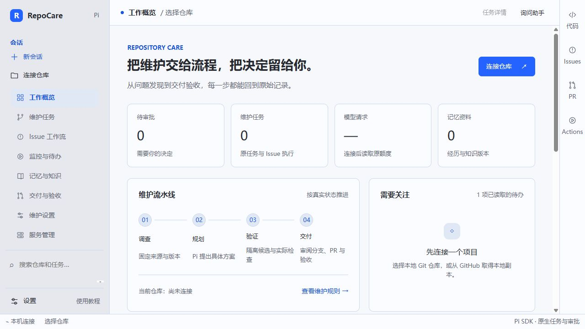

## 2. 设置显示与模型

从「设置」选择语言、主题和字号。到「模型」添加服务商，填入 Base URL 与 API Key 后查询或填写模型 ID。对需要的模型分别设置上下文、输出上限和思考强度。

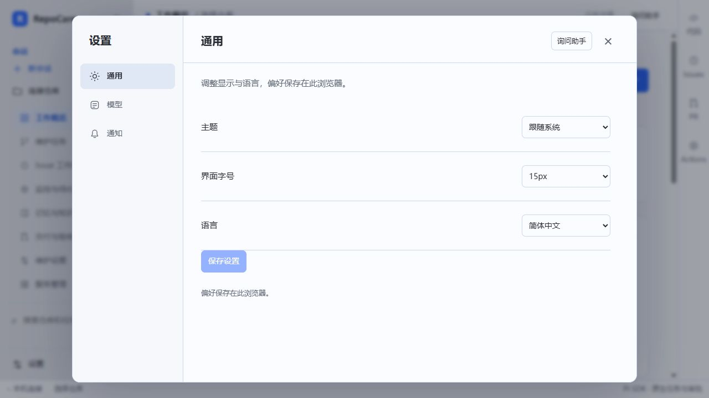
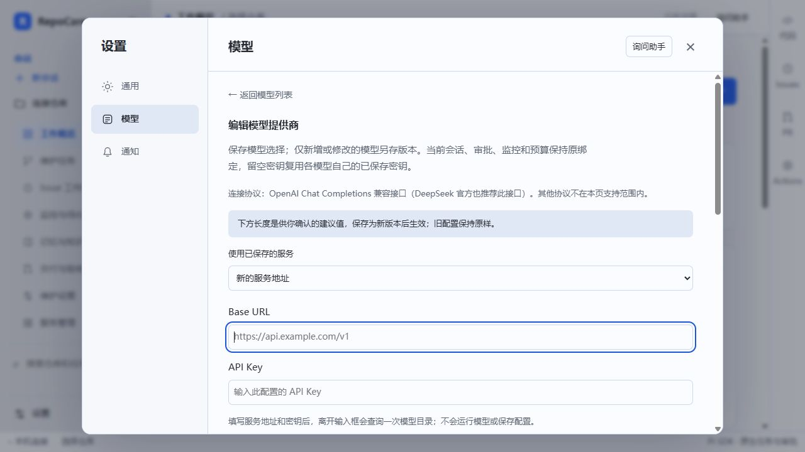
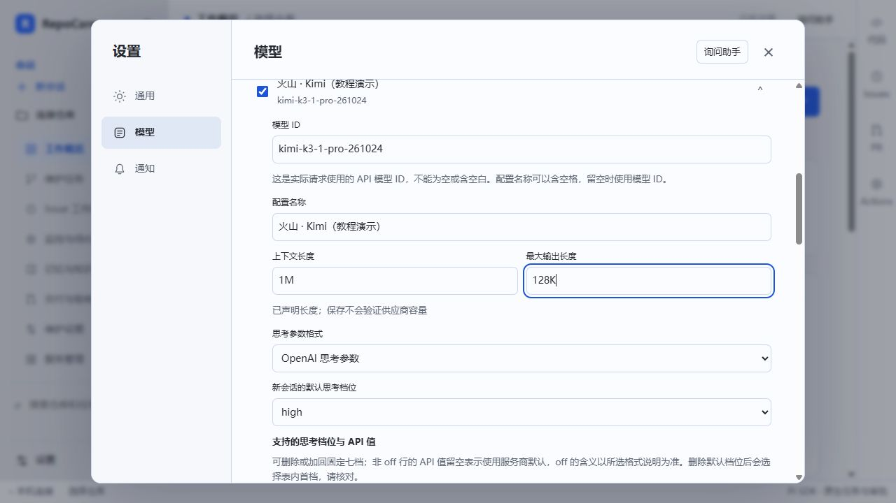
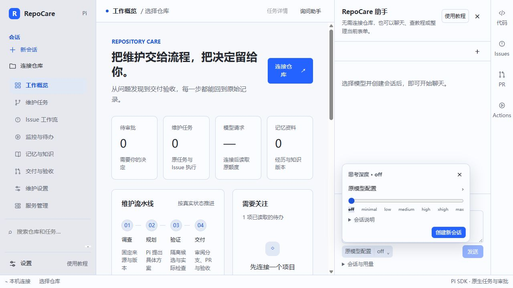

## 3. 连接仓库

点击「连接仓库」。本地项目可以填 Git 仓库根目录并检查。确认维护范围后打开仓库工作台。

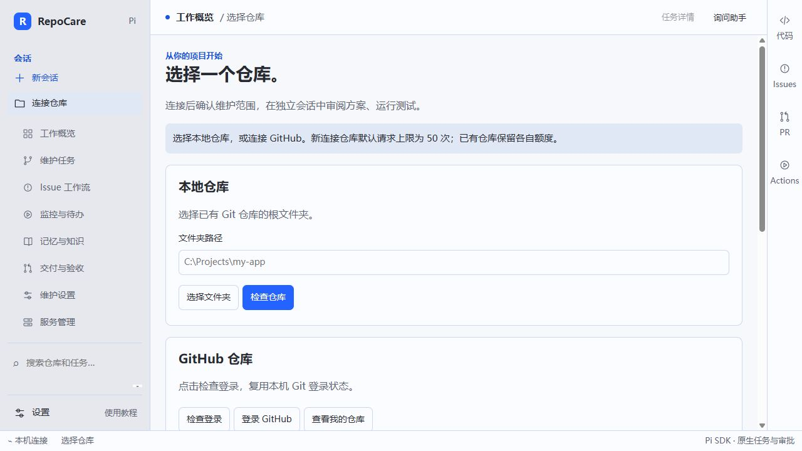
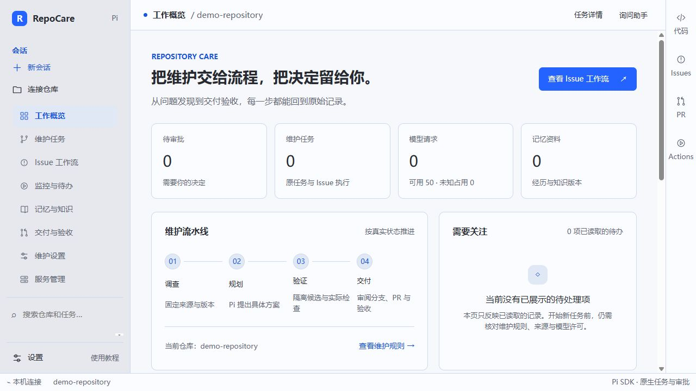

## 4. 发起任务或设置监控

已经知道问题时，可进入「维护任务」描述现象。要让 RepoCare 自行发现提交引入的失败，进入「监控与待办」设置目录规则，预览后确认。若要自动调用模型，另行审阅未来提交的模型授权。候选通过后，到原运行检查修改前后结果及差异。

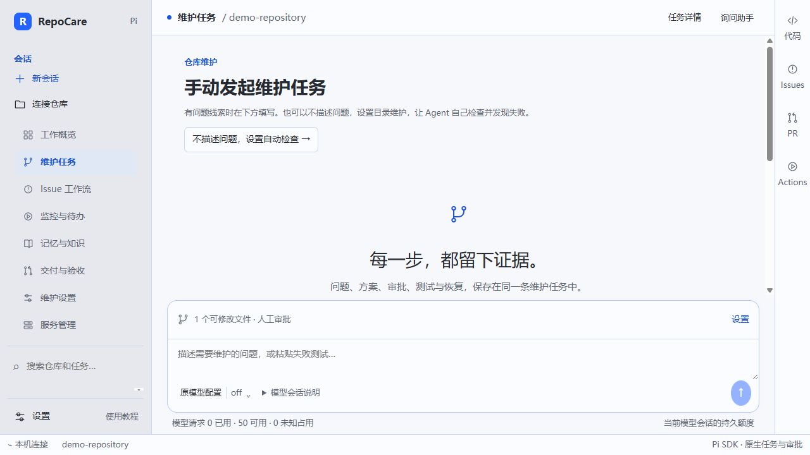
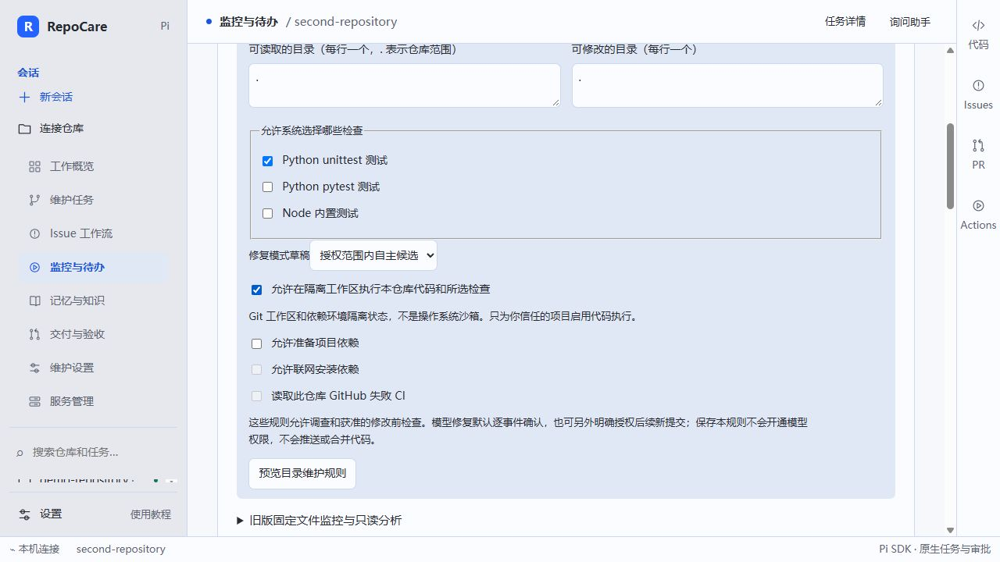
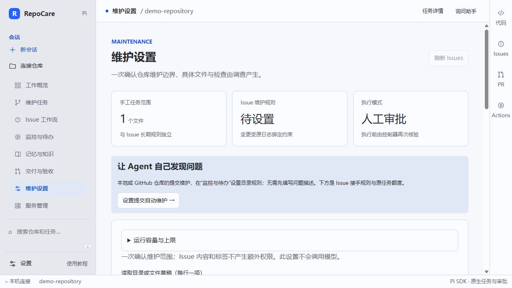

## 5. 查帮助和安全停止

「使用教程」可搜索说明。用完先暂停持续监控或等当前任务完成，再用「服务管理」或 `repocare gateway stop` 停止工作台。

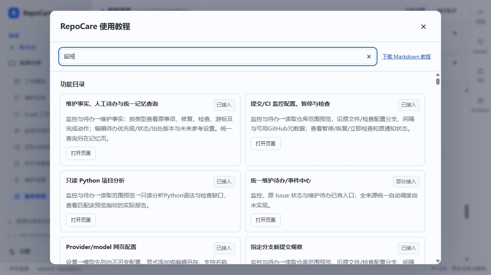
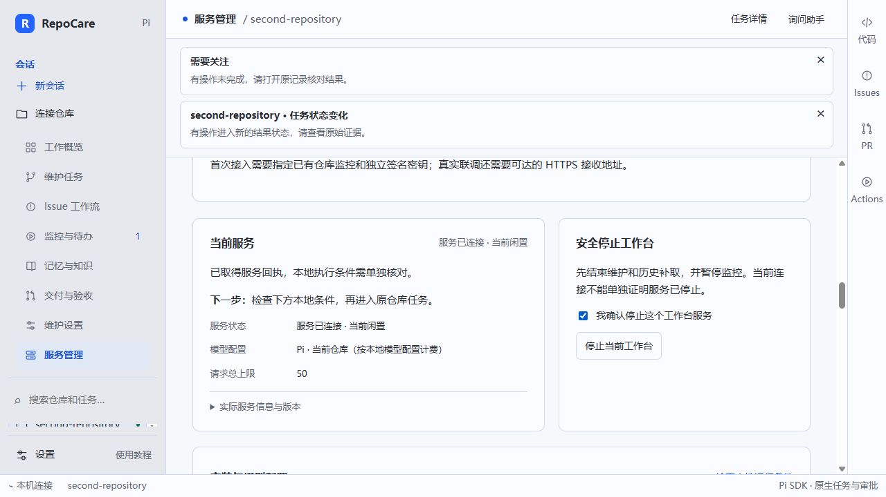
